# TraceHarness guide: why do coding agents fail?

Load SWE-agent trajectories from the public
[nebius/SWE-agent-trajectories](https://huggingface.co/datasets/nebius/SWE-agent-trajectories) dataset into
TraceHarness, then measure, replay and explain the failures. Every number leads down to the recorded step
behind it.

About 30 minutes · runs in your browser · no API key · data: CC BY 4.0. The same guide is online at
<https://traceharness.dev/guide/>.

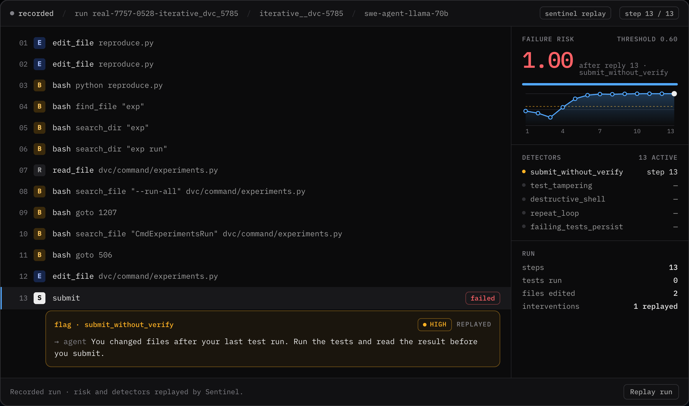

*A failed run replayed in TraceHarness. Sentinel flags the submit that was never tested.*

## Contents

0. [Before you start](#before-you-start)
1. [Open TraceHarness](#1-open-traceharness)
2. [Load the reference dataset](#2-load-the-reference-dataset)
3. [Analyse the trajectories](#3-analyse-the-trajectories)
   - [A. Overview](#a-overview)
   - [B. Trajectory explorer](#b-trajectory-explorer)
   - [C. Run console](#c-run-console)
   - [D. Compare](#d-compare)
   - [E. Trajectory features](#e-trajectory-features)
   - [F. Outcomes](#f-outcomes)
   - [G. Report](#g-report)
4. [Questions to explore](#4-questions-to-explore)
5. [Troubleshooting](#5-troubleshooting)

## Before you start

**You need**

- TraceHarness, open in your browser.
- A network connection for one 85 MB download from Hugging Face.
- No API key: every run here is already recorded.

**You will**

- Load 1,000 real agent trajectories from Hugging Face.
- Read success rates with their intervals.
- Replay a failed run and see where an early warning fires.
- Rank the behaviours that go with failure, and write up what you find.

---

## 1. Open TraceHarness

TraceHarness is a web app that runs next to your data and opens in your browser on port `8765`. It needs no
API key: everything in this guide works on recorded trajectories.

### Start the app

If TraceHarness is already running for you (a GitHub Codespace starts it and opens the tab by itself), switch
to that tab. Otherwise start it from a terminal and open `http://127.0.0.1:8765`:

```bash
python -m harnesslab
```

<details>
<summary>Not installed yet?</summary>

You need Python 3.10 or newer. From the root of this repository, install it with the `real` extra, which adds
the reader for Hugging Face datasets, then start it:

```bash
python3 -m venv .venv && source .venv/bin/activate
pip install -e '.[real]'
python -m harnesslab
```

</details>

### Check your datasets

TraceHarness opens on **Datasets**: every trajectory set in `data/runs/`, recorded agents and mock controls. If
`real_swe_agent_500` is listed, you already have the first 500 runs of the dataset you load next.

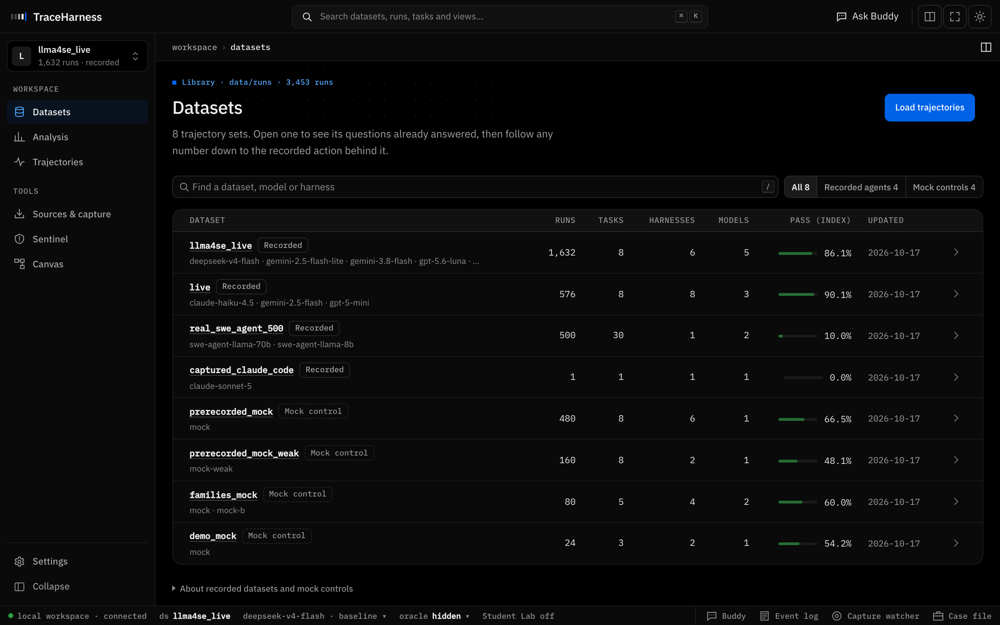

*Datasets: four recorded agents and four mock controls. Open any of them to see its questions already
answered.*

---

## 2. Load the reference dataset

[nebius/SWE-agent-trajectories](https://huggingface.co/datasets/nebius/SWE-agent-trajectories) holds 80,036
runs of SWE-agent, an autonomous coding agent, on real GitHub issues. Each run is one attempt at one issue:
every thought, command and observation, the patch it submitted, and whether the issue's own tests passed
afterwards (*resolved*). You will load the first 1,000 runs.

### Open Sources & capture

In the left rail, click **Sources & capture** (the **Load trajectories** button on Datasets opens the same page)
and scroll to **2 · Download a public sample**.

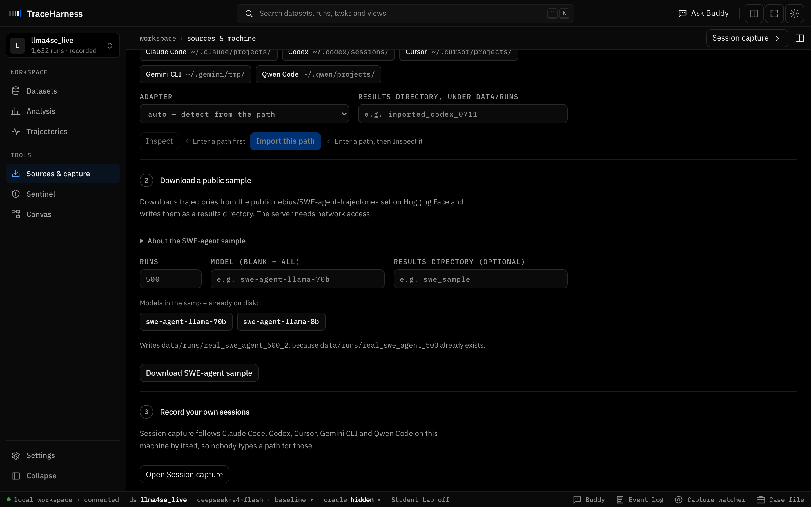

*The download form, before you change anything. With the default 500 runs it would write a second copy of the
bundled sample, and says so.*

### Ask for 1,000 runs

Set **Runs** to `1000`. Leave **Model** and **Results directory** blank: the sample then keeps every model, and
it is written to `data/runs/real_swe_agent_1000`.

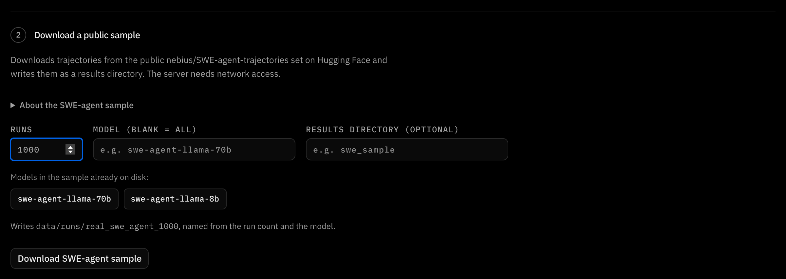

*The line under the form names the directory it will write.*

### Download and import

Click **Download SWE-agent sample**, then **Download & import** to confirm. The server downloads one 85 MB file
from Hugging Face, then writes the 1,000 runs. It usually takes under a minute (6 seconds in our test).

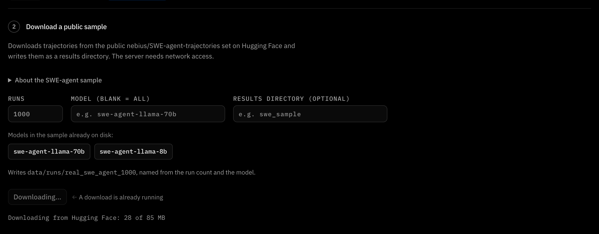

*Progress first counts megabytes from Hugging Face, then the runs being written.*

### Open the dataset

When it finishes, click **Open real_swe_agent_1000**.

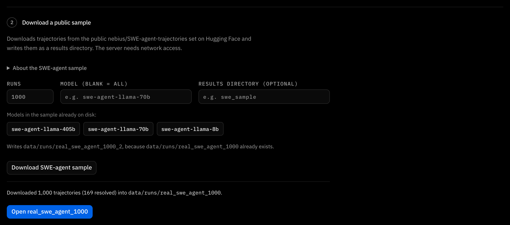

*Done: 1,000 trajectories, 169 of them resolved.*

### What you loaded

| Runs (trajectories) | GitHub issues (tasks) | SWE-agent models | Resolved |
|---:|---:|---|---:|
| 1,000 | 48 | 3: Llama 8B, 70B, 405B | 169 (16.9%) |

> [!TIP]
> **Same numbers.** The download always takes the dataset's first rows, in order. Load **1,000 runs with
> Model and Results directory blank** and every number in this guide is the number on your screen.

> [!NOTE]
> **Offline?** If `real_swe_agent_500` is in your Datasets, it holds the first 500 of the same runs. Every step
> below works on it; only the numbers differ.

---

## 3. Analyse the trajectories

Seven views, from the big picture down to a single step. Each one answers a question you can check against the
recorded runs.

### A. Overview

**Start from the questions, already answered.**
*Where:* Datasets → real_swe_agent_1000 → **Overview**

The dataset opens on nine questions answered from the recorded runs. They are asked of one *condition*, set by
the line at the top: **Asking** the dataset, about a model, under a harness, graded by a test suite. It opens on
the model with the most runs, `swe-agent-llama-70b`.

Start with **How do runs fail?**: 87% of the 831 failed runs are wrong patches. 723 runs submitted a patch that
the issue's tests then rejected. **Where do repeats disagree?** finds 8 of the 48 issues that llama-70b both
resolves and fails. Every number is a link down to the runs behind it. A question marked *not answered* says
why: these runs have one harness and one test suite, so there is nothing to compare them against.

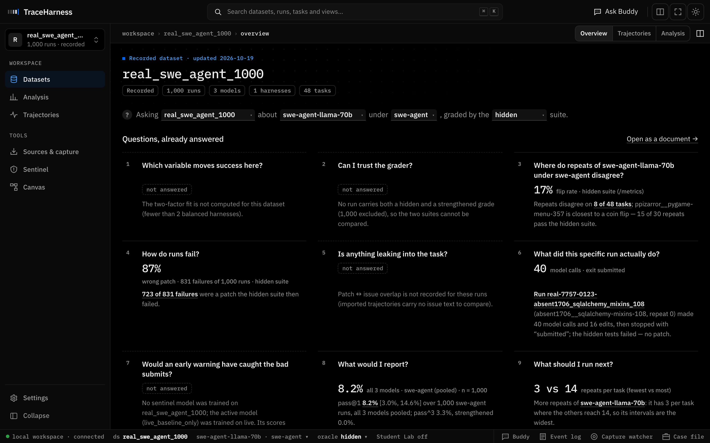

*The overview of real_swe_agent_1000, asked about swe-agent-llama-70b.*

### B. Trajectory explorer

**See every attempt, task by task.**
*Where:* **Trajectories** (top right of the dataset)

One row per task and one square per attempt, in order: ✓ resolved, × not. For llama-70b that is 48 tasks and
834 attempts: 1 task passes every time, 8 flip between pass and fail, 39 never pass. **Mixed outcomes** keeps
the 8 tasks where the same model, on the same issue, both succeeds and fails. That spread is run-to-run
variance. `iterative__dvc-5785`, for example, resolves 9 times out of 46.

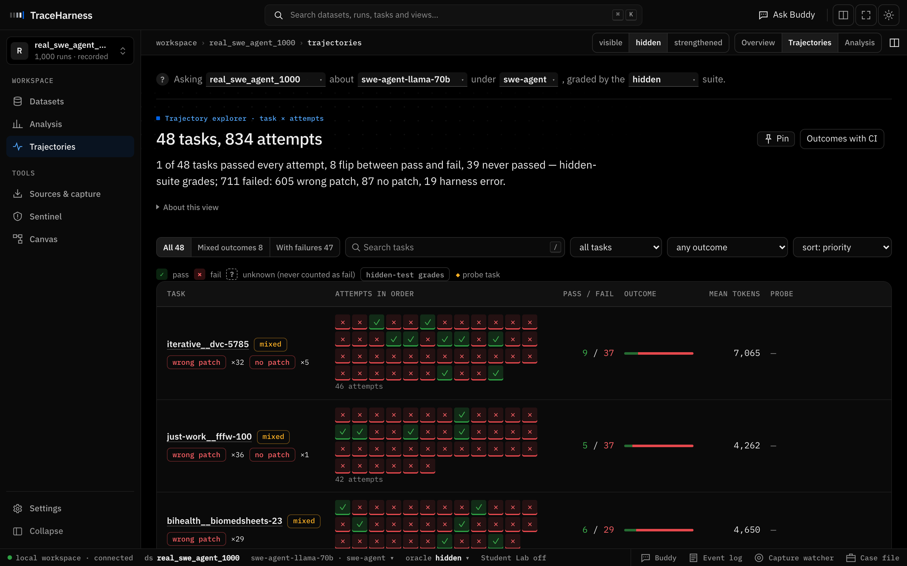

*Each square opens that attempt. The chips under a task name count how its failures ended.*

### C. Run console

**Replay one trajectory, step by step.**
*Where:* click any × square, or search for run `real-7757-0528-iterative_dvc_5785`

**How it failed** summarises the outcome and links to the evidence. Below it, the run console lists every step
the agent took (E edit, R read, B bash, S submit). Beside the steps is the failure risk, which Sentinel,
TraceHarness's early-warning model, recomputes after every step, and the list of detectors that fired.

In this run the agent wrote a reproduction script and ran it once, edited `dvc/command/experiments.py`, and
submitted without running anything again. Sentinel's `submit_without_verify` detector flags the submit at step
13, with the risk at 1.00. **Replay run** plays the trajectory again, step by step.

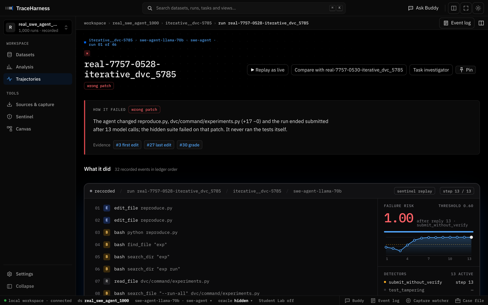

*The run page: the verdict, how it failed, and the evidence chips that jump to the step behind each claim.*


*The run console: 13 steps, the risk curve crossing the 0.60 threshold, and the flag Sentinel raises on the
untested submit.*

### D. Compare

**Put a failed attempt next to a resolved one.**
*Where:* on the run page, **Compare with real-7757-0530-iterative_dvc_5785**

The comparison pairs the run with a repeat that ended differently: `…0530` resolved the same issue with the
same model and harness. The view finds the first step where the two trajectories diverge, here step 1 (one
edits a file, the other runs a search), and aligns the rest. Task, model and harness are identical, so the
difference is run-to-run variance, not the setup.

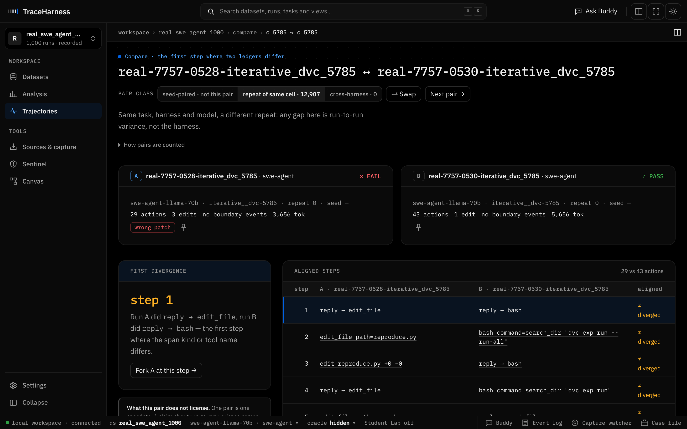

*Compare: the pair class, both outcomes, the first divergence, and the aligned steps.*

### E. Trajectory features

**Find the behaviours that go with failure.**
*Where:* **Analysis** → **5 Trajectory features**

Each run is described by yes/no features: *never verified after the last edit*, *never ran a test*, *repeated a
command more than three times*, *ran out of context*, and so on. Each feature gets an **Ochiai** score. This is
spectrum-based fault localisation with runs in place of program statements: a feature scores high when it shows
up in failed runs and rarely in resolved ones.

On this sample the top feature is **never verified after the last edit** (Ochiai 0.71): 54% of failed runs show
it, against 23% of resolved runs. Read the two rate columns, not only the score: a feature common in every kind
of run ranks high from its base rate alone. The × and ✓ chips open example runs that have the feature.

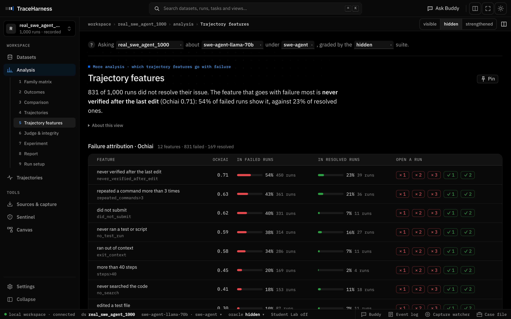

*The ranking, with each feature's rate in failed and in resolved runs, and example runs to open.*

Further down the same page: resolved and unresolved runs side by side, next to the dataset card's figures for
all 80,036 runs; how runs ended; the resolve rate per model; and the action mix.

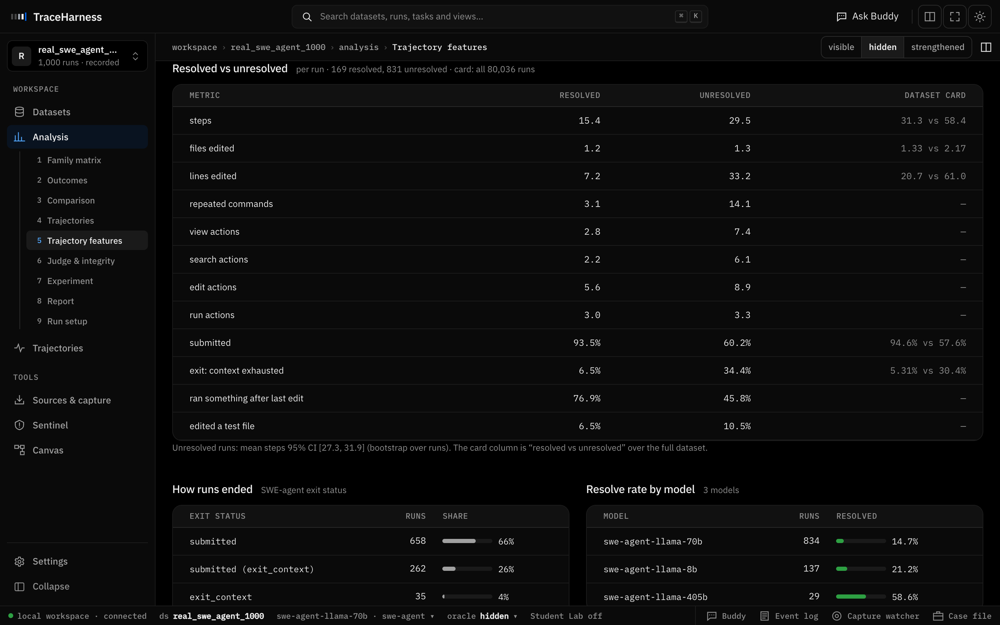

*Unresolved runs take more steps (29.5 vs 15.4) and edit more lines (33.2 vs 7.2), as in the full dataset.*

### F. Outcomes

**Put an interval on it.**
*Where:* **Analysis** → **2 Outcomes**

pass@1 for the condition, with a 95% confidence interval from a bootstrap over tasks. llama-70b resolves 9.7%
[3.4%, 17.2%]. pass^3 (5.7%) is the chance that three attempts in a row all succeed, and the flip rate (17%) is
the share of tasks with mixed outcomes.

pass@1 averages over tasks, so an issue attempted 46 times weighs as much as one attempted three times. That is
why it differs from the pooled 14.7% of llama-70b runs resolved in Trajectory features. Change the model in the
Asking line to compare models: llama-405b reaches 57.6%, but from 29 runs, with an interval from 28.6% to 86.7%.

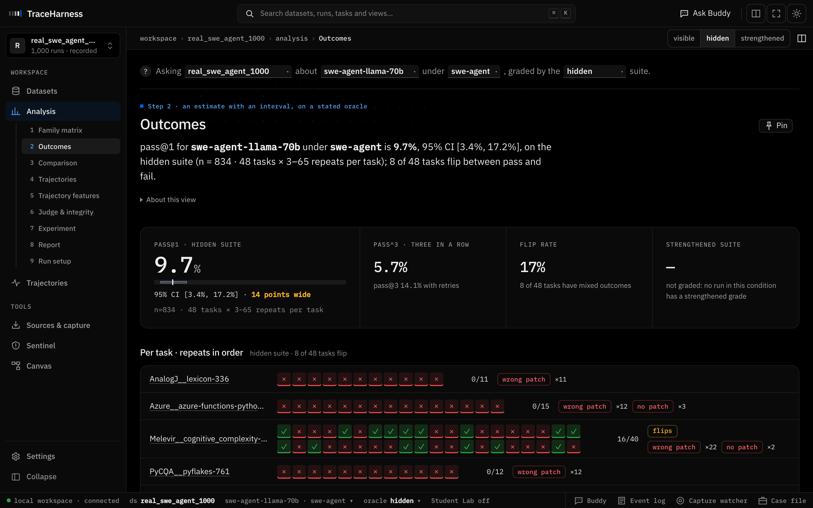

*Outcomes for swe-agent-llama-70b, then every task's attempts in order.*

### G. Report

**Write it up.**
*Where:* **Analysis** → **8 Report**

The report card states the estimate with its interval and its scope, the claims the data supports, and the
caveats. **Export .md** downloads it for your hand-in. As you work, **Pin** any figure or run to the **Case
file** (bottom right) to keep your evidence together.

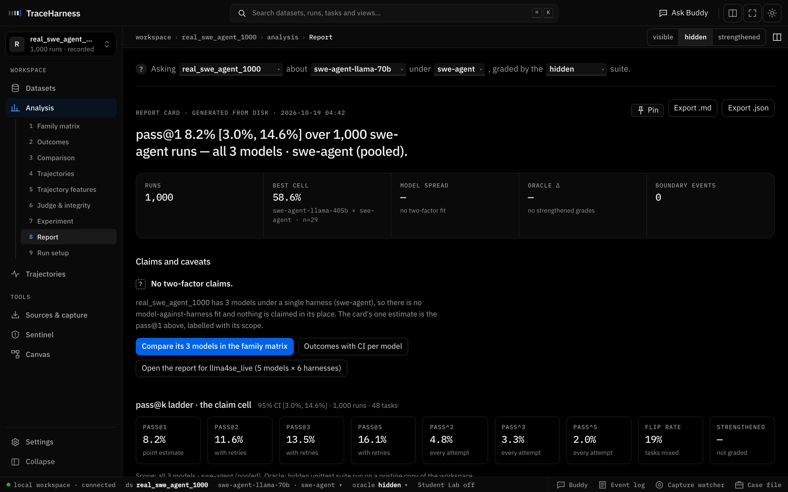

*The report card for the whole sample, all three models pooled.*

> [!TIP]
> **Shortcut.** Press <kbd>⌘</kbd> <kbd>K</kbd> (<kbd>Ctrl</kbd> <kbd>K</kbd> on Windows and Linux) to search
> datasets, runs, tasks and views from anywhere.

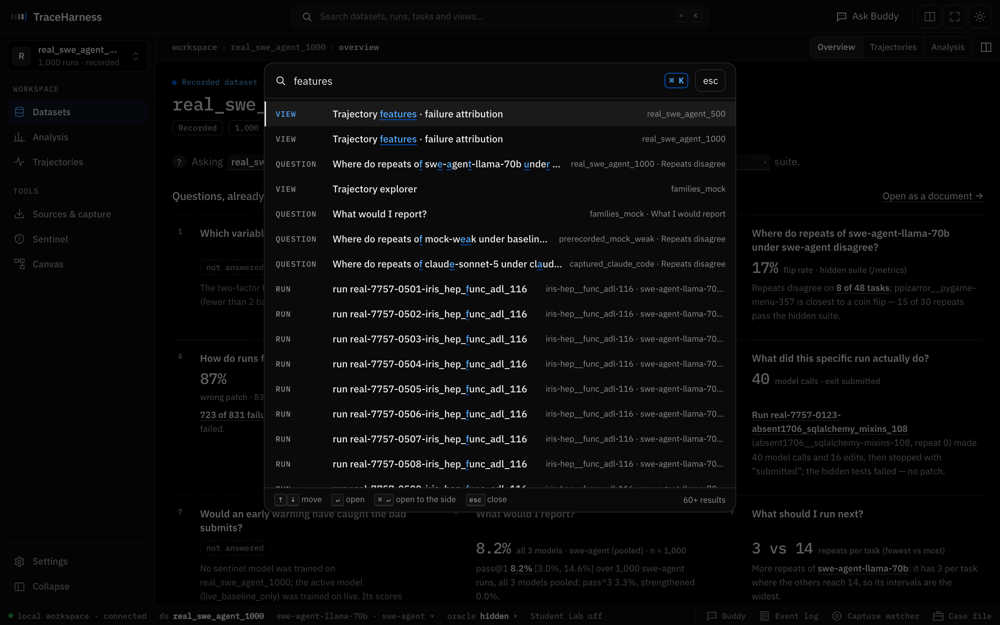

*Type a few letters of a view, run id or task to jump straight to it.*

---

## 4. Questions to explore

Each one can be answered in TraceHarness. Note the ids of the runs you open, so someone else can follow the
same evidence.

1. **Cause or symptom?** *Never verified after the last edit* tops the ranking. Open two failed runs and one
   resolved run from its row. Is the feature a cause of failure, a symptom of an agent that is already lost, or
   an artefact of how SWE-agent was run? Argue from the trajectories.
2. **Base rates.** *Did not submit* scores 0.62 with rates of 40% and 7%. *Repeated a command more than three
   times* scores 0.63 with 43% and 21%. Which one separates failed from resolved runs better, and why does
   Ochiai rank them almost level?
3. **Is the bigger model better?** llama-405b reaches 57.6% pass@1 against llama-70b's 9.7%. Check how many runs
   and which tasks each model has (Family matrix, Outcomes). What would you need before claiming that 405B is
   the better agent?
4. **Same agent, different outcome.** Pick a task with mixed outcomes in the explorer and compare a failed
   attempt with a resolved one. Where do they first diverge? Does that step explain the outcome?
5. **Would an early warning help?** In run `…0528` Sentinel flags the submit at step 13. If the harness had
   blocked that submit and told the agent to run the tests, would the run have resolved its issue? What does a
   false alarm cost?

> [!TIP]
> **Keep it.** **Pin** what you find to the **Case file**, and share the report card with **Export .md**.

---

## 5. Troubleshooting

<details>
<summary>The download fails or never starts</summary>

The server has to reach `huggingface.co`. Click **Retry the download**. If the network is blocked, use
`real_swe_agent_500`, which is already in your workspace.

</details>

<details>
<summary>It says data/runs/real_swe_agent_1000 already exists</summary>

You loaded it before. The form then picks a free name (`real_swe_agent_1000_2`) and says so. You can also type
your own name under **Results directory**.

</details>

<details>
<summary>My numbers differ from this guide</summary>

They match when you load 1,000 runs with Model and Results directory blank, and grade on the **hidden** suite
(the selector at the top right). Another run count or a model filter gives a different sample.

</details>

<details>
<summary>TraceHarness stopped responding</summary>

Start it again with `python -m harnesslab` (a codespace that went idle restarts it when you reopen it). Your
datasets under `data/runs/` are kept.

</details>

<details>
<summary>Where are the files?</summary>

`data/runs/real_swe_agent_1000/` holds one folder per run (`ledger.jsonl` with every step, `summary.json`,
`patch.diff`, `messages.json`), plus `index.jsonl` and `real_features.jsonl`.

The downloaded file is cached in `~/.cache/harnesslab/nebius/`, so a second download skips the network.

</details>

---

Data: [nebius/SWE-agent-trajectories](https://huggingface.co/datasets/nebius/SWE-agent-trajectories)
(CC BY 4.0), via Hugging Face. More on the app: [`docs/STUDENT_GUIDE.md`](STUDENT_GUIDE.md) and
<https://traceharness.dev>.
